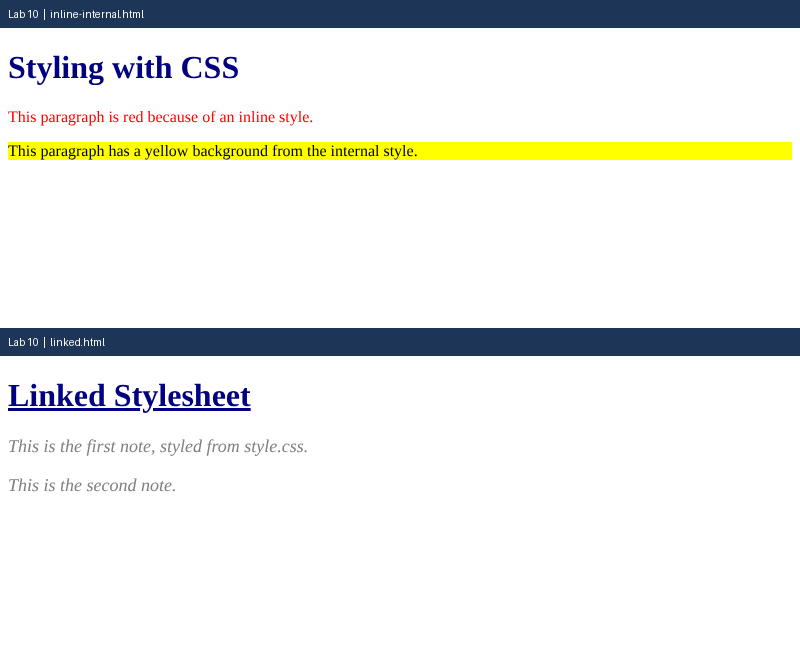

# Lab 10: CSS Fundamentals

**Name:** Anurag Verma
**Roll No:** 2010303123
**Course:** BCS352 - HTML and CSS Introduction Lab, Invertis University

## Aim

Apply CSS in three ways (inline, internal and linked) and use selectors and text styles.

## Files

- `inline-internal.html` - Inline and internal CSS
- `style.css` - External stylesheet
- `linked.html` - Page linked to style.css
- `index.html` - links to all pages of this lab

## How to run

Open `index.html` in a browser and click the links, or open any file directly.

## Output

