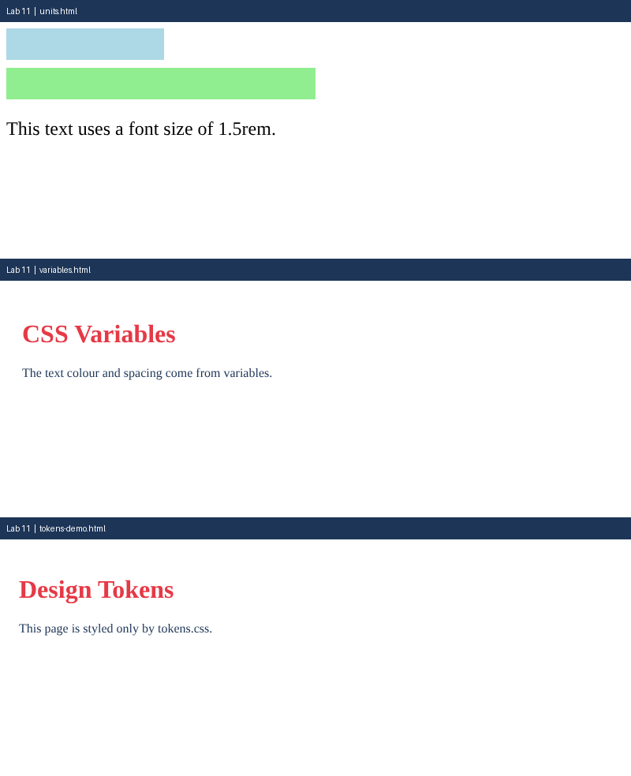

# Lab 11: Units and CSS Variables

**Name:** Anurag Verma
**Roll No:** 2010303123
**Course:** BCS352 - HTML and CSS Introduction Lab, Invertis University

## Aim

Use CSS units and store colours and spacing in variables.

## Files

- `units.html` - px, % and rem units
- `variables.html` - CSS variables in :root
- `tokens.css` - Design tokens stylesheet
- `tokens-demo.html` - Page that links tokens.css
- `index.html` - links to all pages of this lab

## How to run

Open `index.html` in a browser and click the links, or open any file directly.

## Output

