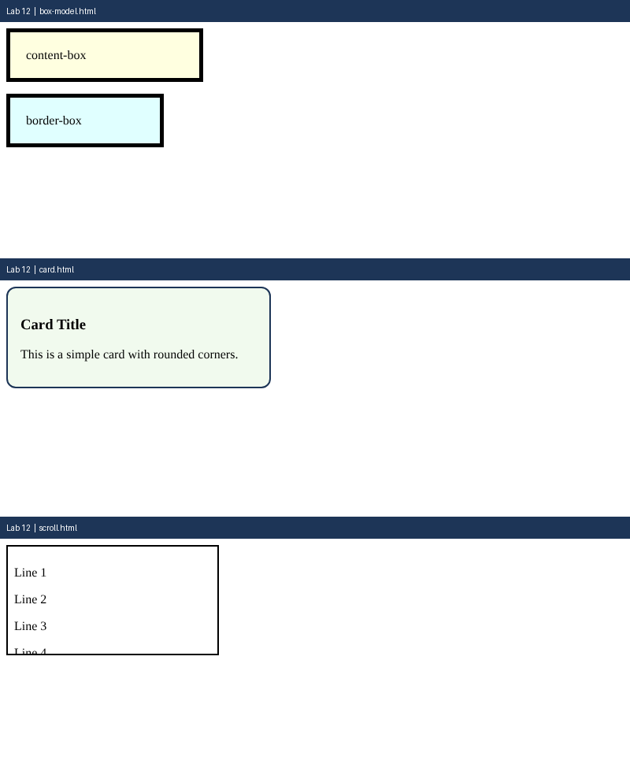

# Lab 12: Box Model, Cards and Scrolling

**Name:** Anurag Verma
**Roll No:** 2010303123
**Course:** BCS352 - HTML and CSS Introduction Lab, Invertis University

## Aim

Compare the box sizing types, style a card and make a box scroll.

## Files

- `box-model.html` - content-box vs border-box
- `card.html` - Styled card
- `scroll.html` - Scrollable box
- `index.html` - links to all pages of this lab

## How to run

Open `index.html` in a browser and click the links, or open any file directly.

## Output

