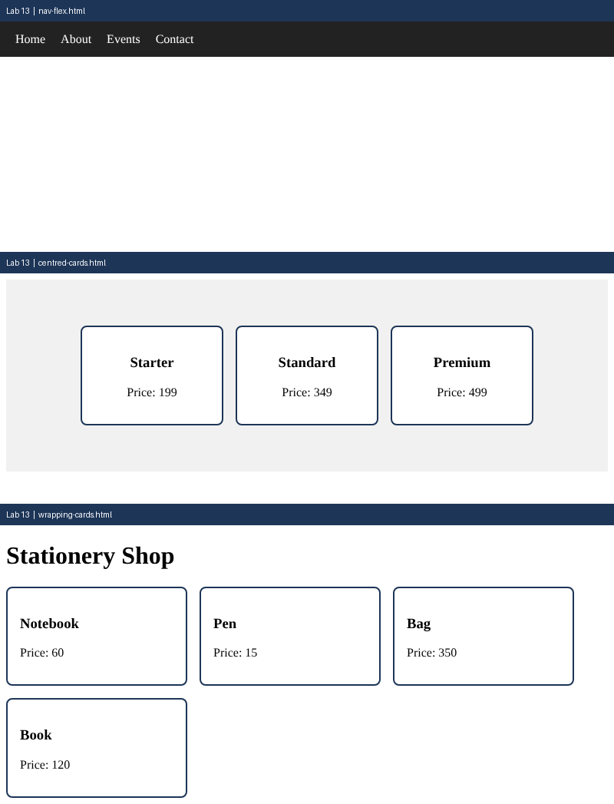

# Lab 13: Flexbox Layouts

**Name:** Anurag Verma
**Roll No:** 2010303123
**Course:** BCS352 - HTML and CSS Introduction Lab, Invertis University

## Aim

Lay out a navigation bar, centred cards and cards that wrap, using Flexbox.

## Files

- `nav-flex.html` - Flex navigation bar
- `centred-cards.html` - Centred cards
- `wrapping-cards.html` - Wrapping cards
- `index.html` - links to all pages of this lab

## How to run

Open `index.html` in a browser and click the links, or open any file directly.

## Output

