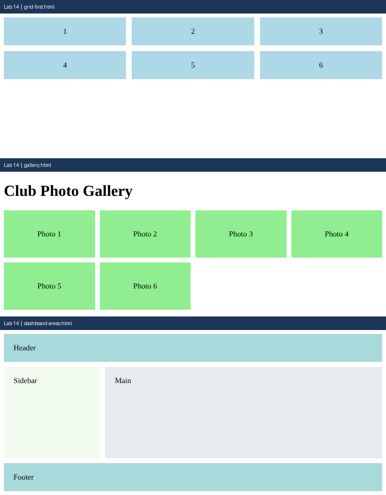

# Lab 14: CSS Grid Layouts

**Name:** Anurag Verma
**Roll No:** 2010303123
**Course:** BCS352 - HTML and CSS Introduction Lab, Invertis University

## Aim

Make a grid with equal columns, a responsive gallery and a layout with named areas.

## Files

- `grid-first.html` - Three-column grid
- `gallery.html` - Responsive gallery
- `dashboard-areas.html` - Named grid areas
- `index.html` - links to all pages of this lab

## How to run

Open `index.html` in a browser and click the links, or open any file directly.

## Output

