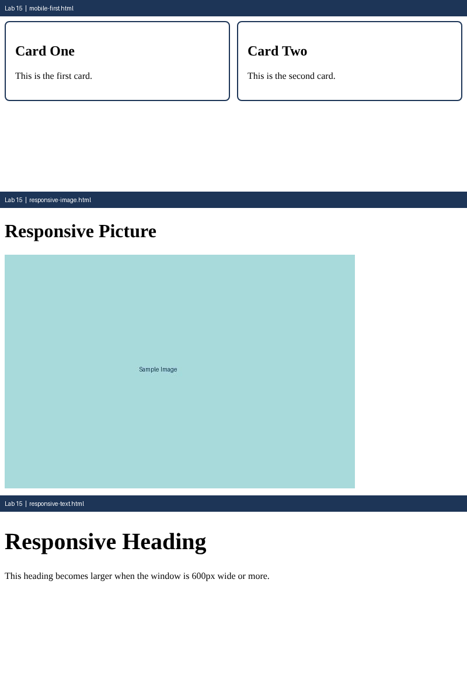

# Lab 15: Responsive Pages with Media Queries

**Name:** Anurag Verma
**Roll No:** 2010303123
**Course:** BCS352 - HTML and CSS Introduction Lab, Invertis University

## Aim

Use a media query to change a layout, make a picture scale with its box, and set text sizes with rem units.

## Files

- `mobile-first.html` - Mobile-first cards
- `responsive-image.html` - Responsive image
- `responsive-text.html` - Responsive text
- `index.html` - links to all pages of this lab

## How to run

Open `index.html` in a browser and click the links, or open any file directly.

## Output

