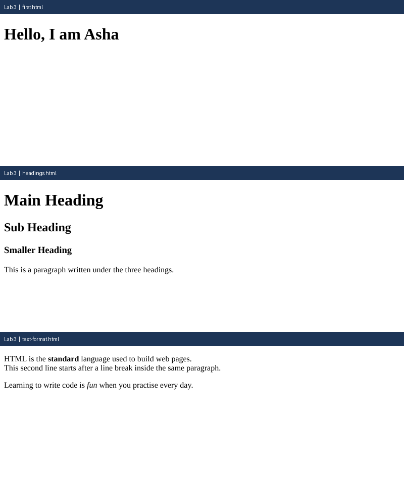

# Lab 3: Your First HTML Page

**Name:** Anurag Verma
**Roll No:** 2010303123
**Course:** BCS352 - HTML and CSS Introduction Lab, Invertis University

## Aim

Write a first HTML page with a title, headings and a paragraph, and format some text.

## Files

- `first.html` - Title and one h1 heading
- `headings.html` - h1, h2, h3 and a paragraph
- `text-format.html` - strong, em and a line break
- `index.html` - links to all pages of this lab

## How to run

Open `index.html` in a browser and click the links, or open any file directly.

## Output

