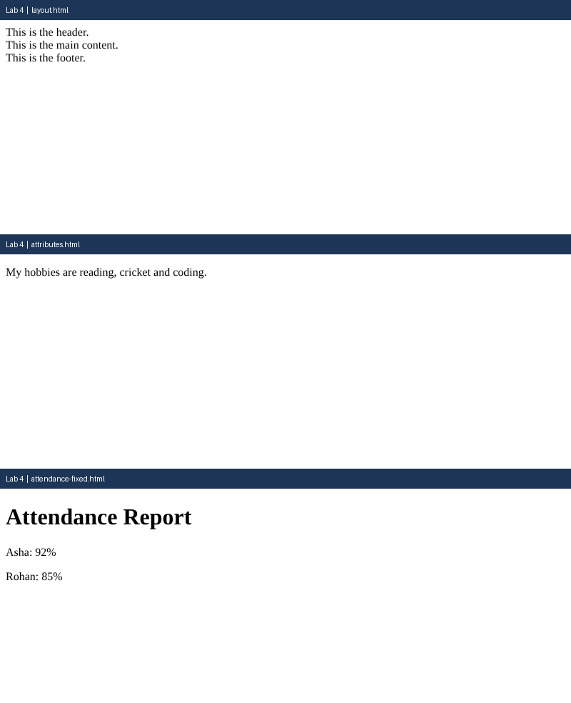

# Lab 4: Divs, Attributes and a Small Fix

**Name:** Anurag Verma
**Roll No:** 2010303123
**Course:** BCS352 - HTML and CSS Introduction Lab, Invertis University

## Aim

Group parts of a page with div elements, add a data attribute, and fix the errors in a broken page.

## Files

- `layout.html` - Header, main and footer divs
- `attributes.html` - id and data-topic attribute
- `attendance-fixed.html` - Corrected broken page
- `index.html` - links to all pages of this lab

## How to run

Open `index.html` in a browser and click the links, or open any file directly.

## Output

