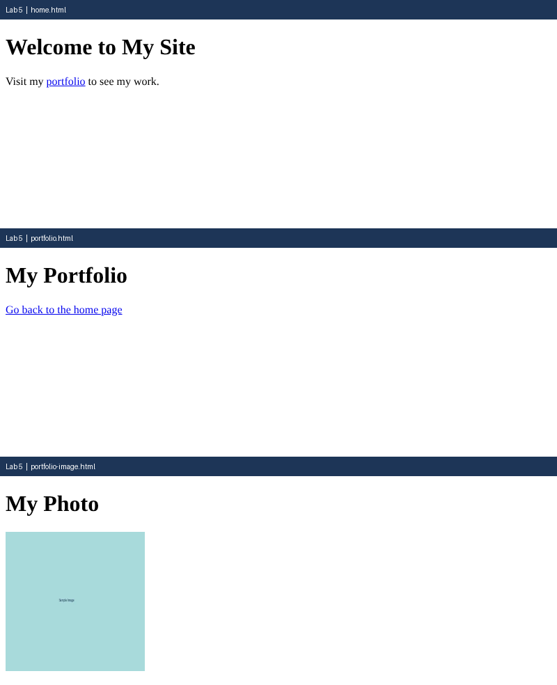

# Lab 5: Links and Images

**Name:** Anurag Verma
**Roll No:** 2010303123
**Course:** BCS352 - HTML and CSS Introduction Lab, Invertis University

## Aim

Link two pages together and add a picture with alt text.

## Files

- `home.html` - Home page with link to portfolio
- `portfolio.html` - Portfolio page with link back
- `portfolio-image.html` - 200x200 image with alt text
- `index.html` - links to all pages of this lab

## How to run

Open `index.html` in a browser and click the links, or open any file directly.

## Output

