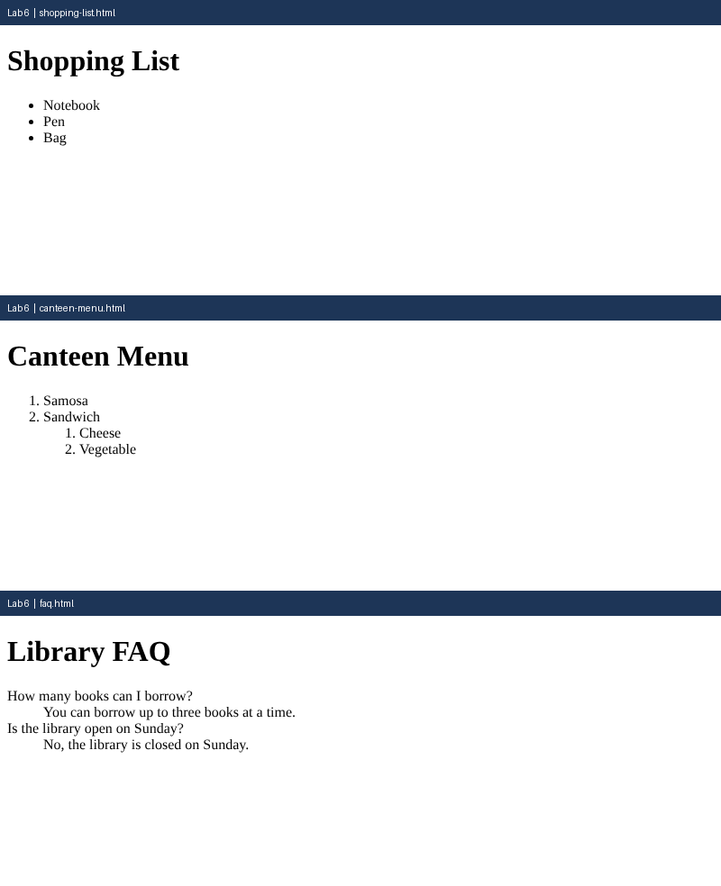

# Lab 6: Types of HTML Lists

**Name:** Anurag Verma
**Roll No:** 2010303123
**Course:** BCS352 - HTML and CSS Introduction Lab, Invertis University

## Aim

Make a bulleted list, a numbered list with a nested list, and a description list.

## Files

- `shopping-list.html` - Unordered list
- `canteen-menu.html` - Ordered list with nested list
- `faq.html` - Description list
- `index.html` - links to all pages of this lab

## How to run

Open `index.html` in a browser and click the links, or open any file directly.

## Output

