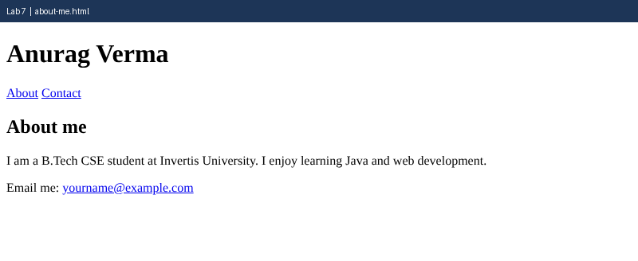

# Lab 7: About Me Page

**Name:** Anurag Verma
**Roll No:** 2010303123
**Course:** BCS352 - HTML and CSS Introduction Lab, Invertis University

## Aim

Build a short About Me page with semantic tags, an about section and a contact link.

## Files

- `about-me.html` - Header, nav, main, section and footer
- `index.html` - links to all pages of this lab

## How to run

Open `index.html` in a browser and click the links, or open any file directly.

## Output

