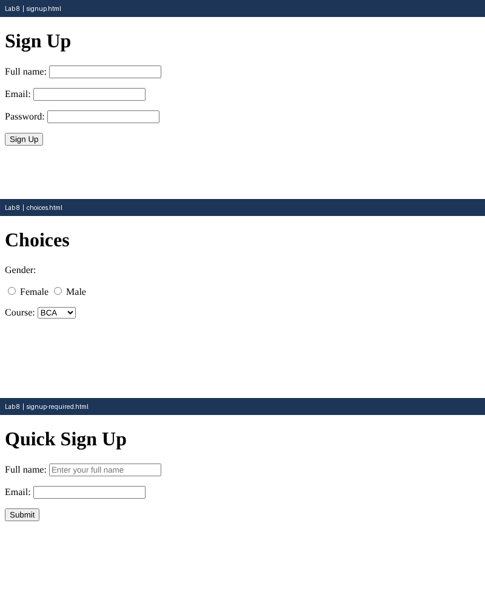

# Lab 8: Sign-Up Forms and Choices

**Name:** Anurag Verma
**Roll No:** 2010303123
**Course:** BCS352 - HTML and CSS Introduction Lab, Invertis University

## Aim

Make a labelled form with text, email and password fields, choices and a submit button.

## Files

- `signup.html` - Labelled sign-up form
- `choices.html` - Radio buttons and dropdown
- `signup-required.html` - Required fields and placeholder
- `index.html` - links to all pages of this lab

## How to run

Open `index.html` in a browser and click the links, or open any file directly.

## Output

