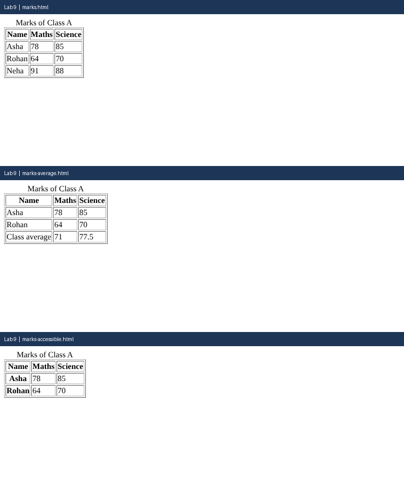

# Lab 9: Tables with Headers and Footers

**Name:** Anurag Verma
**Roll No:** 2010303123
**Course:** BCS352 - HTML and CSS Introduction Lab, Invertis University

## Aim

Build a table with a caption, a header, rows and a footer, and add scope attributes.

## Files

- `marks.html` - Table with thead and tbody
- `marks-average.html` - Table with tfoot averages
- `marks-accessible.html` - Table with scope attributes
- `index.html` - links to all pages of this lab

## How to run

Open `index.html` in a browser and click the links, or open any file directly.

## Output

